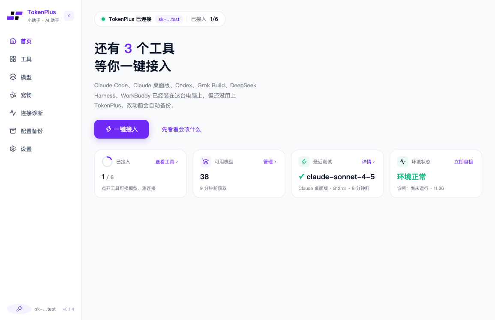
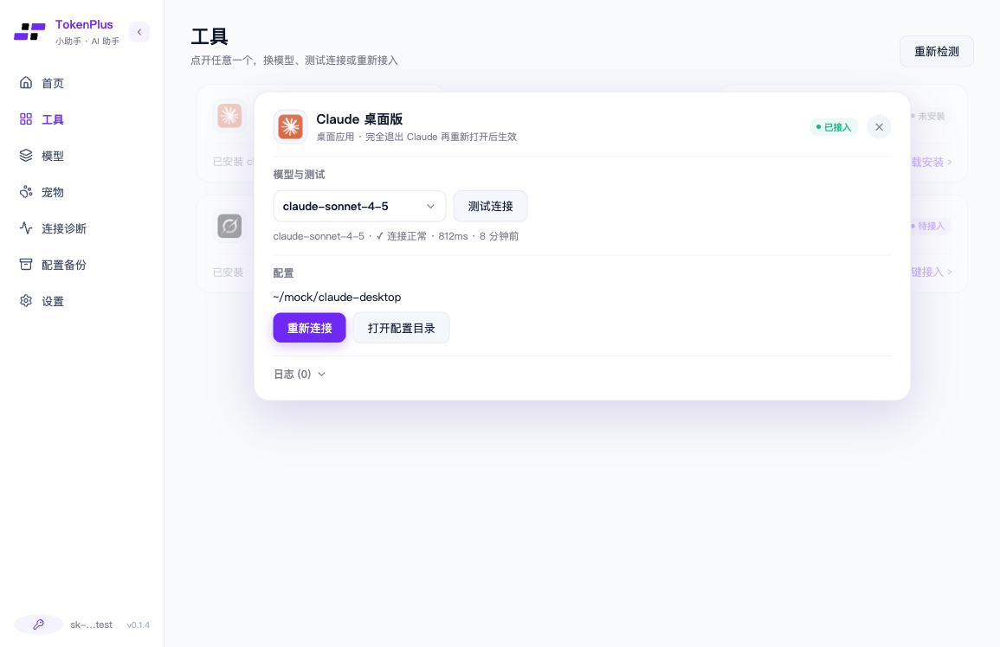
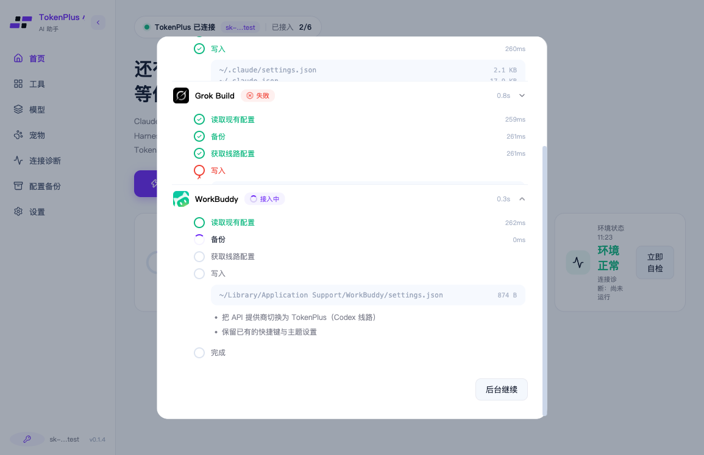

# TokenPlus 小助手

把 Claude Code、Claude 桌面版、Codex、Grok Build、DeepSeek Harness、WorkBuddy 一键接入 [TokenPlus](https://www.tokenplus.cn/)。

提供三种用法，写入的配置完全一致，任选其一：

| 方式 | 适合 | 命令 |
| --- | --- | --- |
| 交互式配置器 | 一次配多个客户端 | `npx tokenplus-helper` |
| 单客户端脚本 | 只配某一个 | `curl -fsSL …/codex-setup.sh \| bash` |
| 桌面客户端 | 想要图形界面、换模型、测试连接、还原备份 | `curl -fsSL …/install.sh \| bash` |

目前只支持 macOS。

## 一、交互式配置器（推荐）

```bash
npx tokenplus-helper
```

没有 Node.js 时用纯 bash 版，流程相同：

```bash
curl -fsSL https://raw.githubusercontent.com/pengcai6/tokenplus-helper-release/main/setup.sh | bash
```

流程：

1. 勾选要配置的客户端（自动检测本机已安装的并默认勾上，可多选）
2. 自动打开 TokenPlus，登录后创建或复制一个 API Key，粘贴到终端回车
3. 从这个 Key 可用的模型里选一个（可以打字筛选）
4. 逐个写入配置，写之前自动备份

```
   ▀█▀ █▀█ █▄▀ █▀▀ █▄ █ █▀█ █   █ █ █▀▀
    █  █▄█ █ █ ██▄ █ ▀█ █▀▀ █▄▄ █▄█ ▄██
   一条命令，把 AI 编程工具接入 TokenPlus

┌  tokenplus setup
│
◆  要配置哪些客户端？  ↑↓ 移动 · 空格勾选 · a 全选 · 回车确认
│  ❯ ◼ Claude Code        已安装
│    ◼ Claude 桌面版      已安装
│    ◼ Codex              已安装
│    ◼ Grok Build         已安装
│    ◻ DeepSeek Harness   未检测到
│    ◼ WorkBuddy          已安装
└
```

不想交互时可以全部用参数给出：

```bash
npx tokenplus-helper --tools claude,codex --key sk-你的key --model 模型名
```

| 参数 | 说明 |
| --- | --- |
| `-t, --tools` | 逗号分隔：`claude,claude-desktop,codex,grok,deepseek,workbuddy` |
| `-k, --key` | TokenPlus API Key，也可以用环境变量 `TOKENPLUS_API_KEY` |
| `-m, --model` | 要使用的模型 |
| `--no-open` | 不自动打开 TokenPlus 网站 |

## 二、单客户端脚本

每个客户端一条命令。运行后自动打开 TokenPlus，把 API Key 粘贴到终端回车，再选一个模型即可。

```bash
# Claude Code
curl -fsSL https://raw.githubusercontent.com/pengcai6/tokenplus-helper-release/main/claude-setup.sh | bash

# Claude 桌面版
curl -fsSL https://raw.githubusercontent.com/pengcai6/tokenplus-helper-release/main/claude-desktop-setup.sh | bash

# Codex
curl -fsSL https://raw.githubusercontent.com/pengcai6/tokenplus-helper-release/main/codex-setup.sh | bash

# Grok Build
curl -fsSL https://raw.githubusercontent.com/pengcai6/tokenplus-helper-release/main/grok-setup.sh | bash

# DeepSeek Harness
curl -fsSL https://raw.githubusercontent.com/pengcai6/tokenplus-helper-release/main/deepseek-setup.sh | bash

# WorkBuddy
curl -fsSL https://raw.githubusercontent.com/pengcai6/tokenplus-helper-release/main/workbuddy-setup.sh | bash
```

也可以直接带上 Key 和模型，不再提问：

```bash
curl -fsSL https://raw.githubusercontent.com/pengcai6/tokenplus-helper-release/main/codex-setup.sh | bash -s -- sk-你的key 模型名
```

### 每个脚本改了什么

所有脚本写入前都会把原文件备份成同目录下的 `*.bak-时间戳`，只改自己负责的那几项，其余内容原样保留；重复运行结果不变。

| 客户端 | 修改的文件 | 内容 |
| --- | --- | --- |
| Claude Code | `~/.claude/settings.json` | 在 `env` 里写入 `ANTHROPIC_BASE_URL`、`ANTHROPIC_AUTH_TOKEN`、`ANTHROPIC_MODEL`，以及 opus / sonnet / haiku 三个档位的模型（都指向选中的同一个模型） |
| Claude 桌面版 | `~/Library/Application Support/Claude-3p/` | 新增一个名为 TokenPlus 的网关配置档并设为当前；模型由桌面版自己从网关读取，在应用里选 |
| Codex | `~/.codex/config.toml` | 写入 `tokenplus` 供应商和默认模型，旧的顶层模型设置改成注释；界面语言设为中文；旧的 `models_cache.json` 改名备份 |
| Grok Build | `~/.grok/config.toml`、Grok 桌面版的 `agent-home/config.toml` | 写入全部可用模型的 `[model."tokenplus/…"]` 段和默认模型 |
| DeepSeek Harness | `~/.dsh/settings.yaml`、`~/.dsh/.credentials.yaml` | 新增 `tokenplus` 供应商和密钥，设为默认模型；保留原有注释 |
| WorkBuddy | `~/.workbuddy/models.json` | 加入全部可用模型（带 `tokenplus-helper` 标记），不动你自己添加的模型 |

几点需要知道：

- **Codex** 会被设置为 `approval_policy = "never"` 和 `sandbox_mode = "danger-full-access"`，也就是执行命令不再逐条询问、不受沙盒限制。不想要的话，配置后把 `~/.codex/config.toml` 开头这两行改掉。
- **Codex** 配置时如果桌面版正在运行，会先请它退出，以便刷新模型列表。
- **Grok** 没装命令行版时，会调用 xAI 官方安装脚本安装；设置环境变量 `TOKENPLUS_NO_INSTALL=1` 可以跳过。
- **Claude Code / Grok** 配置完会用选中的模型发一次很小的真实请求测试连接，会消耗极少量额度。
- API Key 只写入上面列出的本机配置文件，不会发送到 TokenPlus 网关以外的任何地方。

## 三、桌面客户端

```bash
curl -fsSL https://raw.githubusercontent.com/pengcai6/tokenplus-helper-release/main/install.sh | bash
```

脚本会下载最新版、安装到「应用程序」并打开。用这种方式安装不会出现「无法验证开发者」或「已损坏」的提示；重新运行同一行命令即可升级。目前只有 Apple 芯片（M 系列）的安装包。

也可以在 [Releases](https://github.com/pengcai6/tokenplus-helper-release/releases/latest) 手动下载 DMG。首次打开如果被系统拦住，在终端运行：

```bash
xattr -dr com.apple.quarantine "/Applications/TokenPlus 小助手.app"
```

客户端能做的事：

- 一键接入全部客户端，接入前可以预览每个文件会怎么改
- 每个客户端单独换模型，重新获取上游模型列表
- 测试连接：向选中的模型发一句 hi，流式显示回复、首字延迟和总耗时
- 环境自检、连接诊断、配置备份与还原

| 首页 | 工具详情 | 接入过程 |
| --- | --- | --- |
|  |  |  |

## 开发

```
cli/                    终端配置器
  tokenplus.mjs           npx 入口（交互界面）
  src/                    各脚本的源文件：common.sh 是公共部分，其余每个客户端一个
  build.sh                把 src/ 拼成根目录下可独立运行的 *-setup.sh
*-setup.sh, setup.sh    生成出来的脚本，供 curl 直接运行（不要手改）
*-config.mjs            DeepSeek Harness / WorkBuddy 的配置写入逻辑
install.sh              桌面客户端的一键安装脚本
renderer/               桌面客户端前端（Vue 3，无构建步骤）
src-tauri/              桌面客户端后端（Tauri 2 + Rust）
scripts/                打包与发布
```

修改终端脚本：

```bash
# 改 cli/src/ 下的文件，然后重新生成
./cli/build.sh

# 本地试跑（不走网络下载辅助文件）
TOKENPLUS_ASSET_DIR=$PWD bash ./codex-setup.sh
node cli/tokenplus.mjs
```

桌面客户端：

```bash
npm install
npm run dev                 # 开发模式
./scripts/build-dmg.sh      # 打包 DMG（ad-hoc 签名）
./scripts/release.sh        # 打包并上传到 GitHub Releases
```

需要 Rust、Node.js 18+ 和 Xcode 命令行工具。前端可以脱离后端预览：在 `renderer/` 下起一个静态服务器，打开 `index.html?mock=1`。

## 来源说明

各客户端的配置写入逻辑改写自易拓 AI 的一键配置脚本，取密钥和模型的流程换成了 TokenPlus 的。`deepseek-config.mjs` 和 `workbuddy-config.mjs` 保留了原文件的版权声明，按 AGPL-3.0 授权。
